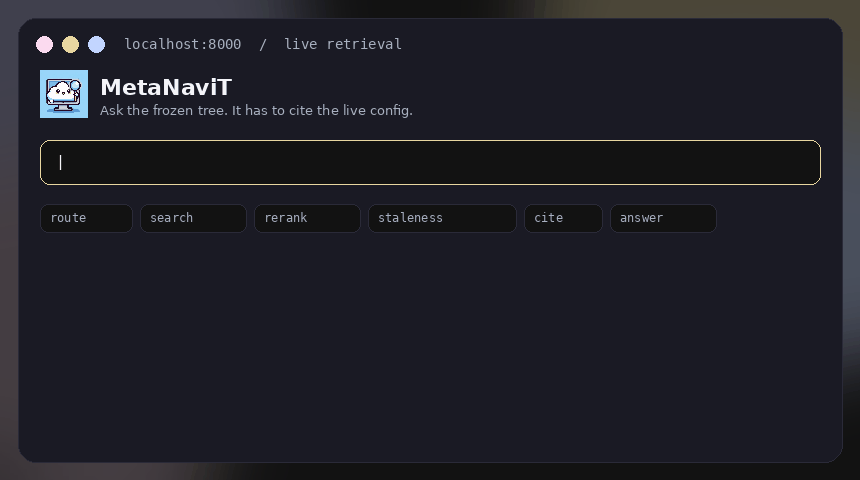
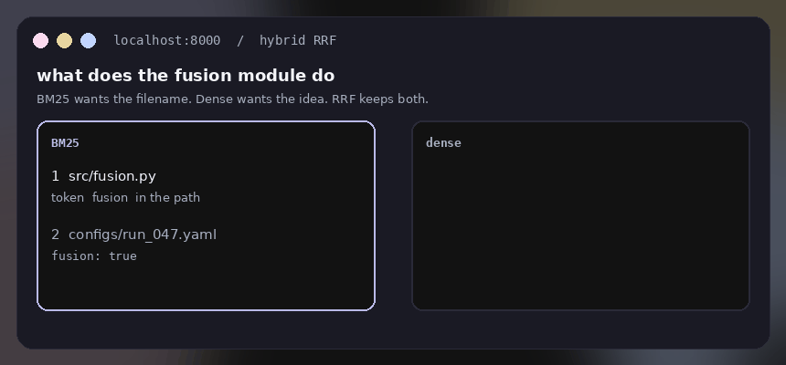
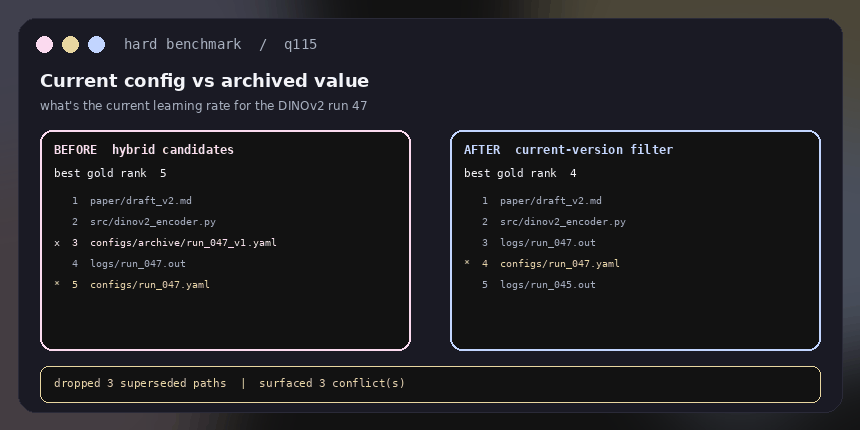
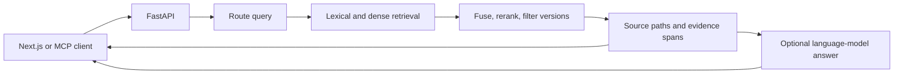

# MetaNaviT — Research File Search and RAG

**Find the right experiment file, inspect its source, and review proposed changes.**

MetaNaviT combines lexical and dense retrieval with source locations, version-aware filtering, and agent tools. A FastAPI service and PostgreSQL/pgvector backend support a Next.js interface; answer generation uses an additional language-model service.

[](https://jose-sanchez-portfolio-com.vercel.app/projects/metanavit/)

*Illustrated fixture interaction, not a live model recording. The project also includes generated traces from its real offline retrieval stack. [Measured fixture demos](doc/engineering-reference.md#hard-benchmark-demos-generated).*

[Visual case study](https://jose-sanchez-portfolio-com.vercel.app/projects/metanavit/) · [Demo walkthroughs](#demo-walkthroughs) · [Run the benchmark](#run-the-cpu-benchmark) · [Architecture](#how-it-works) · [Engineering reference](doc/engineering-reference.md) · [Agent Field mobile companion](mobile/README.md)

## Problem and contribution

Research directories contain near-duplicate configurations, archived results, and claims spread across files. Search needs to return inspectable evidence and distinguish current sources from superseded ones.

**My contribution:** retrieval and data APIs on the original six-person team. My independent 2026 work adds experiment-file provenance, external retrieval evaluations, service-load measurements, and signed approval grants for file operations. [Team attribution](doc/engineering-reference.md#team).

## What it does

- **Retrieve and cite:** combine lexical and dense candidates, rerank when configured, and return source paths and byte ranges.
- **Handle versions:** filter known superseded files and surface conflicts in the evaluated fixtures.
- **Support agents:** expose search and source inspection through HTTP/MCP; the research companion is read-only.
- **Review changes:** the separate file-operation tools propose plans and require externally signed, single-use approval tokens to apply them.
- **Measure regressions:** keep deterministic fixture checks, real-model experiments, and external-domain evaluations separate.

## Demo walkthroughs

### Combine exact terms with semantic matches

[](doc/engineering-reference.md#hybrid-search)

*Illustrated ranking flow. The displayed Recall@50 comes from the 61-file fixture, where retrieving most files makes coverage easy; it is not a claim about external-domain ranking quality.*

### Keep archived evidence from becoming the answer

[](doc/engineering-reference.md#staleness-under-contradiction)

*Generated traces for fixture questions `q115` and `q117`: remove known superseded paths and surface conflicting claims. These two cases illustrate the mechanism; aggregate results are reported separately. [Trace data](doc/demo/traces.json) · [Case manifest](bench/demo/manifest.json).*

## Evidence and limits

**Evidence checked October 14, 2026.** The latest committed retrieval and HTTP-load additions are from the October 7 campaign. These are stored measurements; this README refresh does not claim a new evaluation run.

| Evaluation | Published finding | Scope |
| --- | --- | --- |
| NFCorpus | Hybrid nDCG@10 **0.3637**, versus **0.3207** for BM25 | 323 official test queries; the added reranker reduced the hybrid score. [Results](bench/results/revamp_20261007/beir_nfcorpus_gpu_rescored.json) |
| FiQA | Dense nDCG@10 **0.3848**, versus **0.3645** for hybrid | 648 test queries; hybrid is not the best choice on every corpus. [Results](bench/results/revamp_20261007/beir_fiqa_gpu.json) |
| Robotics-file lookup | Path context increased source-file Recall@10 **0.058 → 0.671** | 240 generated test questions with disjoint experiment families; this measures file retrieval, not answer correctness. [Results](bench/results/robotics_file_lookup_revalidated_2026-10-07.json) |
| Neural HTTP service | Client p95 **252 / 422 / 1,319 ms** at concurrency **1 / 4 / 16** | H100, 600 files, 5,633 nodes; 16 requests per level, all 48 measured requests succeeded. A short workload, not a capacity claim. [Results](bench/results/revamp_20261007/http_robotics_gpu_fp16_512/http_load.json) |

The small frozen fixture uses **hash embeddings and overlap reranking**. Its full pipeline does not establish an overall ranking improvement over BM25. Model-backed retrieval, generated answers, and mobile fixture replays have different dependencies and evidence. [Full generated measurements](#generated-benchmark-evidence) · [HTTP load studies](doc/engineering-reference.md#measured-neural-http-service).

The generated-answer study is separate from retrieval ranking. Its judge-validity gate could not be evaluated on the saturated reference slice, so judge scores remain withheld. [Answer-evaluation artifact](bench/results/jury.json).

## How it works



| Concern | Source |
| --- | --- |
| Retrieval and evaluation | [`app/retrieval/`](app/retrieval/), [`app/eval/`](app/eval/) |
| PostgreSQL retrieval | [`app/database/`](app/database/) |
| API and web interface | [`main.py`](main.py), [`.frontend/`](.frontend/) |
| MCP tools and action approval | [`app/mcp/`](app/mcp/) |
| Read-only research companion | [Setup and contracts](doc/research-companion.md) |

**Engineering decisions:** exact-path queries can skip embedding/reranking; benchmark results retain losing configurations; source text remains separate from added search context. The default Docker stack uses PostgreSQL lexical ranking and hash embeddings to make retrieval reproducible without a model download. [Tradeoffs and system details](doc/engineering-reference.md#how-the-app-is-put-together).

## Run the CPU benchmark

Use Python **3.11 or 3.12**, Git, and Make. This path needs no GPU, database, model download, or LLM service.

```bash
git clone https://github.com/joses2017smjh/MetaNavT.git
cd MetaNavT
python3.11 -m venv .venv
source .venv/bin/activate
python -m pip install -e ".[eval]"
make test-eval
make bench
make bench-gate
```

`make bench` writes a new result and `bench/results/latest.json`; `make bench-gate` compares it with the committed baseline. Keep the frozen corpus unchanged when reproducing the published table. [Dependency specification](pyproject.toml) · [CI](.github/workflows/ci.yml).

## Run the retrieval API

From the cloned repository, with Docker Compose available:

```bash
docker compose up --build -d --wait
curl -s http://localhost:8000/health
curl -s -X POST http://localhost:8000/api/retrieve/ \
  -H 'content-type: application/json' \
  -d '{"query":"current learning rate for run 47"}'
python3 scripts/smoke_retrieve.py --require-bm25
docker compose down
```

The default stack indexes the committed 61-file fixture. Responses disclose the PostgreSQL `ts_rank_cd` lexical fallback, hash embedder, and absent neural reranker. This is a retrieval API demo; generated chat additionally needs Ollama, and the default image does not build the Next.js interface. [Full application, real models, and deployment options](doc/engineering-reference.md#run-it).

<a id="android-and-ios-companion-backend"></a>

## Explore further

- [Feature walkthrough and research history](doc/engineering-reference.md)
- [Research agent setup](doc/research-companion.md) and [Android/iOS companion](mobile/README.md)
- [Experiment source manifest](bench/robotics/2026-10-07/manifest.json) and [question provenance](bench/robotics/2026-10-07/questions.jsonl)
- [Prototype features and their limits](doc/engineering-reference.md#prototypes-not-evaluated)

**Stack:** Python, FastAPI, PostgreSQL/pgvector, Next.js, TypeScript, MCP, Docker; optional BGE embeddings/reranking and Ollama generation.

## Generated benchmark evidence

These tables remain generated from committed artifacts. `make bench-table-check` and the existing README tests detect drift; `make bench-table-write` updates the marked blocks. The engineering reference explains each protocol and its limits.

<details>
<summary>Open fixture, neural, external-domain, API, and answer-evaluation tables</summary>

<a id="bench-headline"></a>

### Fixture summary

<!-- bench-headline:start (generated by `make bench-table` from bench/results/main.json; do not edit by hand) -->
On the frozen fixture (136 questions over 61 files; hash embeddings, overlap reranker) the full pipeline scores nDCG@10 0.493 [0.452, 0.538] and Recall@10 0.748 [0.691, 0.804]; BM25 alone scores nDCG@10 0.505 [0.454, 0.555] and Recall@10 0.730 [0.664, 0.793]. Paired delta, full pipeline minus BM25: nDCG@10 -0.013 [-0.063, +0.039] (the interval covers zero), Recall@10 +0.018 [-0.037, +0.080] (the interval covers zero). Staleness Tier 1 on vs off: nDCG@10 +0.036 [+0.027, +0.047] (the interval excludes zero). Of the added components (rerank, router, staleness), the nDCG@10 gain over the previous row that excludes zero: staleness. The router's exact-path gain, nDCG@10 0.875 → 0.938, rests on n = 8 questions. Recall@50 is 0.938 against 0.662 for a random list of the same length: with 40 unique files in a top-50 over 61, that metric mostly measures list length.
<!-- bench-headline:end -->

<a id="bench-table"></a>

### Fixture ablations

<!-- bench-table:start (generated by `make bench-table` from bench/results/main.json; do not edit by hand) -->
| config | nDCG@10 [95% CI] | Recall@10 [95% CI] | random list @10 | Recall@50 | random list @50 | unique files in top 50 | MRR@10 |
|---|---:|---:|---:|---:|---:|---:|---:|
| dense_only | 0.272 [0.226, 0.322] | 0.480 [0.408, 0.553] | 0.164 | 0.915 | 0.742 | 45.2 | 0.233 |
| bm25_only | 0.505 [0.454, 0.555] | 0.730 [0.664, 0.793] | 0.152 | 0.843 | 0.587 | 35.8 | 0.462 |
| hybrid | 0.454 [0.402, 0.511] | 0.662 [0.600, 0.727] | 0.164 | 0.938 | 0.751 | 45.8 | 0.430 |
| hybrid+rerank | 0.452 [0.412, 0.496] | 0.747 [0.690, 0.803] | 0.164 | 0.938 | 0.751 | 45.8 | 0.391 |
| hybrid+rerank+router | 0.456 [0.415, 0.502] | 0.745 [0.689, 0.801] | 0.158 | 0.938 | 0.714 | 43.5 | 0.402 |
| hybrid+rerank+router+staleness | 0.493 [0.452, 0.538] | 0.748 [0.691, 0.804] | 0.158 | 0.938 | 0.662 | 40.4 | 0.464 |

Paired deltas (same bootstrap resamples for both sides):

| config | Δ nDCG@10 vs bm25_only [95% CI] | Δ Recall@10 vs bm25_only [95% CI] | Δ nDCG@10 vs previous row [95% CI] |
|---|---:|---:|---:|
| dense_only | -0.233 [-0.293, -0.173] | -0.250 [-0.334, -0.161] | — |
| bm25_only | — | — | +0.233 [+0.173, +0.293] (vs dense_only) |
| hybrid | -0.051 [-0.093, -0.006] | -0.068 [-0.133, +0.004] | -0.051 [-0.093, -0.006] (vs bm25_only) |
| hybrid+rerank | -0.053 [-0.102, -0.003] | +0.017 [-0.039, +0.077] | -0.002 [-0.040, +0.036] (vs hybrid) |
| hybrid+rerank+router | -0.049 [-0.098, +0.004] | +0.015 [-0.039, +0.077] | +0.005 [-0.009, +0.019] (vs hybrid+rerank) |
| hybrid+rerank+router+staleness | -0.013 [-0.063, +0.039] | +0.018 [-0.037, +0.080] | +0.036 [+0.027, +0.047] (vs hybrid+rerank+router) |

Per category, hybrid+rerank+router+staleness (n is the number of gold questions; no intervals at these sizes):

| category | n | nDCG@10 | Recall@10 | Recall@50 |
|---|---:|---:|---:|---:|
| simple_factual | 80 | 0.485 | 0.800 | 0.919 |
| conditional | 8 | 0.235 | 0.494 | 0.950 |
| comparative | 8 | 0.363 | 0.542 | 1.000 |
| aggregation | 10 | 0.333 | 0.465 | 1.000 |
| multi_hop | 8 | 0.493 | 0.656 | 0.938 |
| staleness | 8 | 0.547 | 0.875 | 1.000 |
| exact_path | 8 | 0.938 | 1.000 | 1.000 |
| semantic | 6 | 0.707 | 0.750 | 0.833 |

Per-category paired deltas vs parent, where the mechanism targets one category (small n, no claim beyond the slice):

- `hybrid+rerank+router` vs `hybrid+rerank` on `exact_path`, n = 8 (small n): nDCG@10 +0.062 [+0.000, +0.188] (the interval covers zero), Recall@10 +0.000 [+0.000, +0.000].
- `hybrid+rerank+router+staleness` vs `hybrid+rerank+router` on `staleness`, n = 8 (small n): nDCG@10 +0.064 [+0.009, +0.155] (the interval excludes zero), Recall@10 +0.000 [+0.000, +0.000].

Intervals: percentile bootstrap over queries, one index matrix shared by all configs (paired deltas); 2000 resamples, seed 0, numpy.random.RandomState.randint. Results file sha ee782ab, corpus sha f1ba038674e7.
<!-- bench-table:end -->

<a id="bench-neural"></a>

### Neural models on the fixture

<!-- bench-neural:start (generated by `make bench-table` from bench/results/neural.json; do not edit by hand) -->
Fixture v1 with real models (`make bench-neural`, cuda (Quadro RTX 8000), torch 2.5.1+cu121, sentence-transformers 6.1.0; results sha ee782ab). Each row names its parent (one change away); the paired delta is against that parent. Wall time is the whole row after a warm-up query.

| config | parent | models (revision) | nDCG@10 [95% CI] | Recall@10 [95% CI] | Δ nDCG@10 vs parent [95% CI] | Δ vs bm25_only | beats BM25? | wall s |
|---|---|---|---:|---:|---:|---:|:---:|---:|
| bm25_only | — | hash / overlap | 0.505 [0.454, 0.555] | 0.730 [0.664, 0.793] | — | — | n/a | 0.2 |
| dense_only@bge-small | bm25_only | BAAI/bge-small-en-v1.5@5c38ec7 | 0.565 [0.509, 0.619] | 0.751 [0.692, 0.806] | +0.060 [+0.002, +0.118] | +0.060 [+0.002, +0.118] | yes | 3.4 |
| hybrid@bge-small | dense_only@bge-small | BAAI/bge-small-en-v1.5@5c38ec7 | 0.696 [0.646, 0.745] | 0.820 [0.768, 0.872] | +0.131 [+0.087, +0.175] | +0.190 [+0.144, +0.234] | yes | 3.3 |
| hybrid+bge-rerank@hash | bm25_only | BAAI/bge-reranker-v2-m3@953dc6f | 0.814 [0.768, 0.858] | 0.881 [0.835, 0.924] | +0.308 [+0.262, +0.354] | +0.308 [+0.262, +0.354] | yes | 53.5 |
| hybrid+bge-rerank@bge-small | hybrid@bge-small | BAAI/bge-small-en-v1.5@5c38ec7, BAAI/bge-reranker-v2-m3@953dc6f | 0.812 [0.765, 0.856] | 0.879 [0.835, 0.921] | +0.116 [+0.076, +0.160] | +0.307 [+0.259, +0.353] | yes | 48.1 |
| hybrid+bge-rerank+router@bge-small | hybrid+bge-rerank@bge-small | BAAI/bge-small-en-v1.5@5c38ec7, BAAI/bge-reranker-v2-m3@953dc6f | 0.808 [0.762, 0.852] | 0.869 [0.824, 0.911] | -0.004 [-0.025, +0.016] | +0.302 [+0.254, +0.350] | yes | 36.7 |
| hybrid+bge-rerank+router+staleness@bge-small | hybrid+bge-rerank+router@bge-small | BAAI/bge-small-en-v1.5@5c38ec7, BAAI/bge-reranker-v2-m3@953dc6f | 0.824 [0.781, 0.865] | 0.873 [0.829, 0.915] | +0.017 [+0.008, +0.027] | +0.319 [+0.272, +0.364] | yes | 33.7 |
| dense_only@bge-base | bm25_only | BAAI/bge-base-en-v1.5@a5beb1e | 0.701 [0.647, 0.749] | 0.842 [0.791, 0.890] | +0.196 [+0.141, +0.249] | +0.196 [+0.141, +0.249] | yes | 3.9 |
| hybrid@bge-base | dense_only@bge-base | BAAI/bge-base-en-v1.5@a5beb1e | 0.756 [0.704, 0.804] | 0.846 [0.801, 0.891] | +0.056 [+0.022, +0.089] | +0.251 [+0.214, +0.290] | yes | 3.8 |

Hybrid RRF over dense bge-small: nDCG@10 +0.131 [+0.087, +0.175] (the interval excludes zero). bge-reranker-v2-m3 over that hybrid: nDCG@10 +0.116 [+0.076, +0.160] (the interval excludes zero). Router on top of the reranked hybrid: nDCG@10 -0.004 [-0.025, +0.016] (the interval covers zero). Staleness Tier 1 on top of that: nDCG@10 +0.017 [+0.008, +0.027] (the interval excludes zero). With the reranker on, the first stage stops mattering on this fixture: bge-small + reranker 0.812 vs hash + reranker 0.814, paired delta -0.002 [-0.009, +0.006] (the interval covers zero), because the reranker rescores 50 of 71 chunks.

Per-category paired deltas vs parent (small n):

- `hybrid+bge-rerank+router@bge-small` vs `hybrid+bge-rerank@bge-small` on `exact_path`, n = 8 (small n): nDCG@10 +0.201 [+0.046, +0.342] (the interval excludes zero), Recall@10 +0.000 [+0.000, +0.000].
- `hybrid+bge-rerank+router+staleness@bge-small` vs `hybrid+bge-rerank+router@bge-small` on `staleness`, n = 8 (small n): nDCG@10 +0.050 [+0.000, +0.142] (the interval covers zero), Recall@10 +0.000 [+0.000, +0.000].
<!-- bench-neural:end -->

<a id="bench-beir"></a>

### BEIR SciFact

<!-- bench-beir:start (generated by `make bench-table` from bench/results/beir_scifact.json; do not edit by hand) -->
BEIR SciFact test split (`make bench-beir`): 5183 documents (title + ' ' + text), 300 queries; cuda (Quadro RTX 8000), torch 2.5.1+cu121, sentence-transformers 6.1.0; results sha ee782ab. Published BM25 nDCG@10 = 0.6789, [Anserini BEIR regression, flat BM25](https://github.com/castorini/anserini/blob/master/docs/regressions/regressions-beir-v1.0.0-scifact.flat.md), Lucene English (Porter stemming + stopwords), k1=0.9, b=0.4. Each row names its parent; per-query p50/p95 exclude build (index, document embeddings, model load: the build column) and one warm-up query.

| config | parent | models (revision) | reranker precision / max_length / depth | nDCG@10 [95% CI] | Recall@10 [95% CI] | Recall@100 [95% CI] | Δ nDCG@10 vs parent [95% CI] | Δ vs bm25 | beats BM25? | p50 / p95 ms | build s |
|---|---|---|---|---:|---:|---:|---:|---:|:---:|---:|---:|
| bm25 | — | hash / overlap | — | 0.677 [0.630, 0.719] | 0.803 [0.757, 0.845] | 0.929 [0.899, 0.956] | — | — | n/a | 19.43 / 29.24 | 16.3 |
| bm25@default-tokenizer | bm25 | hash / overlap | — | 0.601 [0.552, 0.649] | 0.718 [0.665, 0.766] | 0.821 [0.776, 0.862] | -0.076 [-0.104, -0.047] | -0.076 [-0.104, -0.047] | no | 28.48 / 41.56 | 0.5 |
| dense@bge-small | bm25 | BAAI/bge-small-en-v1.5@5c38ec7 | — | 0.720 [0.674, 0.761] | 0.845 [0.802, 0.885] | 0.953 [0.927, 0.973] | +0.043 [+0.011, +0.077] | +0.043 [+0.011, +0.077] | yes | 17.09 / 37.12 | 9.9 |
| dense@bge-small+instruction | dense@bge-small | BAAI/bge-small-en-v1.5@5c38ec7 | — | 0.713 [0.668, 0.756] | 0.836 [0.792, 0.877] | 0.942 [0.913, 0.965] | -0.007 [-0.021, +0.005] | +0.036 [+0.003, +0.068] | yes | 19.07 / 41.98 | 0.0 |
| hybrid@bge-small | dense@bge-small | BAAI/bge-small-en-v1.5@5c38ec7 | — | 0.738 [0.694, 0.778] | 0.860 [0.820, 0.895] | 0.962 [0.937, 0.982] | +0.018 [-0.007, +0.041] | +0.061 [+0.039, +0.083] | yes | 36.81 / 53.48 | 0.0 |
| hybrid+bge-rerank@bge-small | hybrid@bge-small | BAAI/bge-small-en-v1.5@5c38ec7, BAAI/bge-reranker-v2-m3@953dc6f | fp32 / uncapped / top 20 | 0.752 [0.708, 0.792] | 0.865 [0.824, 0.902] | 0.962 [0.937, 0.982] | +0.014 [-0.010, +0.041] | +0.075 [+0.053, +0.101] | yes | 923.21 / 1745.23 | 5.6 |
| hybrid+bge-rerank@bge-small/fp16-512/top20 | hybrid+bge-rerank@bge-small | BAAI/bge-small-en-v1.5@5c38ec7, BAAI/bge-reranker-v2-m3@953dc6f | fp16 / 512 / top 20 | 0.754 [0.711, 0.794] | 0.871 [0.832, 0.908] | 0.962 [0.937, 0.982] | +0.002 [-0.008, +0.010] | +0.077 [+0.054, +0.102] | yes | 191.21 / 244.41 | 5.2 |
| hybrid+bge-rerank@bge-small/fp16-512/top50 | hybrid+bge-rerank@bge-small/fp16-512/top20 | BAAI/bge-small-en-v1.5@5c38ec7, BAAI/bge-reranker-v2-m3@953dc6f | fp16 / 512 / top 50 | 0.742 [0.697, 0.783] | 0.856 [0.814, 0.892] | 0.962 [0.937, 0.982] | -0.012 [-0.020, -0.005] | +0.065 [+0.041, +0.090] | yes | 378.08 / 413.1 | 0.0 |
| hybrid+bge-rerank@bge-small/fp16-512/top100 | hybrid+bge-rerank@bge-small/fp16-512/top50 | BAAI/bge-small-en-v1.5@5c38ec7, BAAI/bge-reranker-v2-m3@953dc6f | fp16 / 512 / top 100 | 0.736 [0.692, 0.779] | 0.850 [0.807, 0.887] | 0.962 [0.937, 0.982] | -0.005 [-0.011, -0.001] | +0.060 [+0.035, +0.085] | yes | 668.4 / 729.87 | 0.0 |

Our BM25 with the same analyzer and document text scores nDCG@10 0.677 against Anserini's published 0.6789 (-0.0022). Dense bge-small vs BM25: nDCG@10 +0.043 [+0.011, +0.077] (the interval excludes zero), p50 17.09 ms. The bge-v1.5 query instruction vs no instruction: nDCG@10 -0.007 [-0.021, +0.005] (the interval covers zero), p50 19.07 ms. Hybrid RRF over dense: nDCG@10 +0.018 [-0.007, +0.041] (the interval covers zero), p50 36.81 ms. bge-reranker-v2-m3 (top 20, fp32, uncapped) over the hybrid: nDCG@10 +0.014 [-0.010, +0.041] (the interval covers zero), p50 923.21 ms. fp16 with max_length 512 vs fp32 uncapped: nDCG@10 +0.002 [-0.008, +0.010] (the interval covers zero), p50 191.21 ms. Rerank depth 50 vs 20: nDCG@10 -0.012 [-0.020, -0.005] (the interval excludes zero), p50 378.08 ms. Depth 100 vs 50: nDCG@10 -0.005 [-0.011, -0.001] (the interval excludes zero), p50 668.4 ms.
<!-- bench-beir:end -->

<a id="bench-parity"></a>

### API and in-memory parity

<!-- bench-parity:start (generated by `make bench-table` from bench/results/parity.json; do not edit by hand) -->
Same 136 questions, same metrics, same paired bootstrap (`make parity`, results sha 90ce661). The in-memory row is the bench harness with the switches the API serves in CI: hybrid RRF, router on, staleness Tier 1 on, no reranker, hash embeddings. The API row is POST /api/retrieve/ over Postgres + pgvector (one SQL round trip, app/database/sql/hybrid_tsrank.sql).

| row | nDCG@10 [95% CI] | Recall@10 [95% CI] | Recall@50 | lexical leg | chunker | p50 / p95 ms per query |
|---|---:|---:|---:|---|---|---:|
| in_memory:hybrid+router+staleness | 0.515 [0.462, 0.570] | 0.705 [0.643, 0.765] | 0.938 | in-memory Okapi BM25 | app/chunking (structure-aware) | 0.02 / 0.02 |
| api:postgres | 0.535 [0.493, 0.581] | 0.786 [0.736, 0.837] | 0.950 | ts_rank_cd | SentenceSplitter(512, 50) | 9.89 / 33.3 |

Gate: nDCG@10 gap, API minus in-memory, +0.0203 with paired 95% CI +0.020 [-0.026, +0.065] (the interval covers zero); tolerance 0.06; passes. The API's e2e latency is client-measured over HTTP on the machine that produced the results file; the in-memory figure is the search stage only.
<!-- bench-parity:end -->

<a id="api-latency"></a>

### Recorded API latency

<!-- api-latency:start (generated by `make bench-table` from bench/results/api_latency_*.json; do not edit by hand) -->
| stack | embedder | reranker | degraded | server total p50 / p95 ms | e2e p50 / p95 ms | embed / hybrid_sql / rerank p50 ms | questions |
|---|---|---|---|---:|---:|---:|---:|
| docker compose ml (CPU, same models) | HuggingFaceEmbedding | BAAI/bge-reranker-v2-m3@953dc6f on cpu (fp32, max_length 512, depth 20) | none | 3744.18 / 5143.85 | 3746.38 / 5146.14 | 13.84 / 4.21 / 3769.05 | 136 |

Per-query, k = 8, one warm-up excluded; server total is the sum of the API's own stage timers, e2e includes HTTP.
<!-- api-latency:end -->

<a id="bench-jury"></a>

### Answer evaluation

<!-- bench-jury:start (generated by `make bench-table` from bench/results/jury.json; do not edit by hand) -->
Generated answers on fixture v1 (`make bench-jury`, answers and judge labels generated at sha 09c2d68; deterministic checks and summary recomputed by `make bench-jury-rescore` at sha 750ec45): 136 questions, retrieval `hybrid+bge-rerank+router+staleness@bge-small-en-v1.5` (the configured reranker loaded), top 8 chunks, generator qwen2.5:7b via Ollama (temperature 0, seed 0), judges qwen2.5:7b, llama3.1:8b; wall 8885.8 s. The generator is also one of the judges, so that judge's scores carry self-preference risk.

Deterministic checks (no model involved):

| check | result | n |
|---|---:|---:|
| answers with no valid citation (failed loud, excluded from judging) | 2 | 136 |
| abstentions (NOT IN SOURCES) | 7 | 136 |
| every cited path is in the retrieved set (answers with at least one citation) | 0.9844 | 128 |
| every number / config value appears in the cited bytes (answers that state a value) | 0.9222 | 90 |
| ... appears anywhere in the retrieved evidence (looser) | 0.9889 | 90 |
| exact match vs gold (numeric-equivalent), simple_factual | 1.0 | 80 |

Value checks are string containment, case-insensitive; a value written in a different numeric format than the file (0.0003 for 3e-4) counts as missing, and a value the model computed (an average) is missing by design.

Does the judge agree with the gold labels? Cohen's kappa between each judge's label and the exact-match label on simple_factual; the gate is kappa >= 0.6.

| judge | kappa vs exact match | n | passes gate | labels correct / partial / wrong |
|---|---:|---:|:---:|---|
| heuristic (heuristic token overlap, not an LLM) | 0.0 | 80 | no (not evaluable) | 47 / 5 / 28 |
| qwen2.5:7b | 0.0 | 80 | no (not evaluable) | 79 / 1 / 0 |
| llama3.1:8b | 0.0 | 80 | no (not evaluable) | 79 / 1 / 0 |
| jury majority (qwen2.5:7b, llama3.1:8b) | 0.0 | 80 | no (not evaluable) | — |

The gate could not be evaluated on this run. The exact-match reference is one class (80 correct, 0 partial, 0 wrong of 80): the generator answered every simple-factual question with the gold value, so Cohen's kappa is 0 by construction for any judge that ever varies and 1 for a judge that never does. The gate therefore stays closed and no judge score is printed; the computed kappa and each judge's labels are kept above. The slice is saturated for this generator; the gate needs a reference with variance.

Judge-judge agreement (qwen2.5:7b vs llama3.1:8b): kappa 0.3796, n = 134.

Position bias, AB/BA swap (LLM answer vs the extractive answer, same judge, both orders). A flip means the judge picked whichever answer was listed first, i.e. it was not comparing content; the mean position gap is the share of the verdict explained by order (0 = none, 1 = all).

| judge | P(LLM answer better) | mean position gap | order flips | n |
|---|---:|---:|---:|---:|
| qwen2.5:7b | 0.3228 | 0.4366 | 61 / 134 | 134 |
| llama3.1:8b | 0.3843 | 0.3657 | 69 / 134 | 134 |

Verdict: gate not evaluable: the exact-match reference on simple_factual is one class (80 correct, 0 partial, 0 wrong of 80), so Cohen's kappa is 0 by construction for any judge with variance and 1 for a judge that never varies; judge scores stay off the README Mean judge scores are in the results file but are not printed here.

The reference the judges are measured against is itself limited: the exact-match label counts an answer as correct when it contains the gold string or an equal number, so a negated or hedged answer that still quotes the value passes, and a correct paraphrase fails. A low kappa is a disagreement with that reference, not proof that a judge is wrong; the deterministic checks above are the part that does not depend on either.
<!-- bench-jury:end -->

</details>
